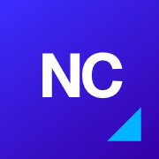
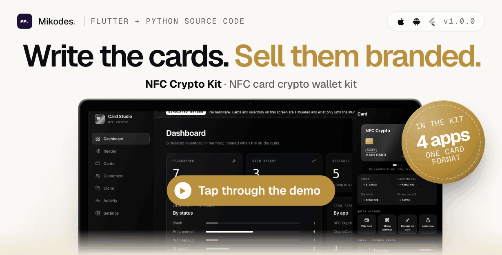
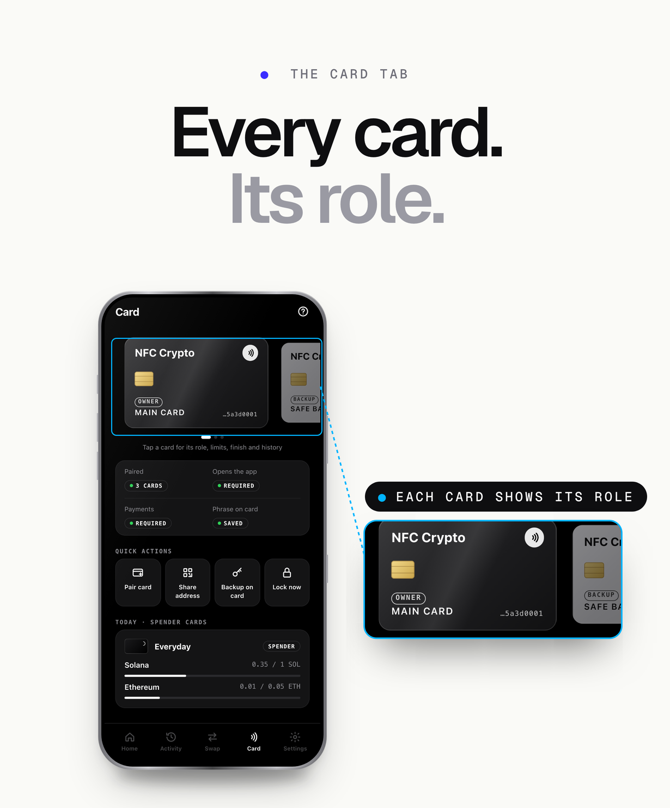
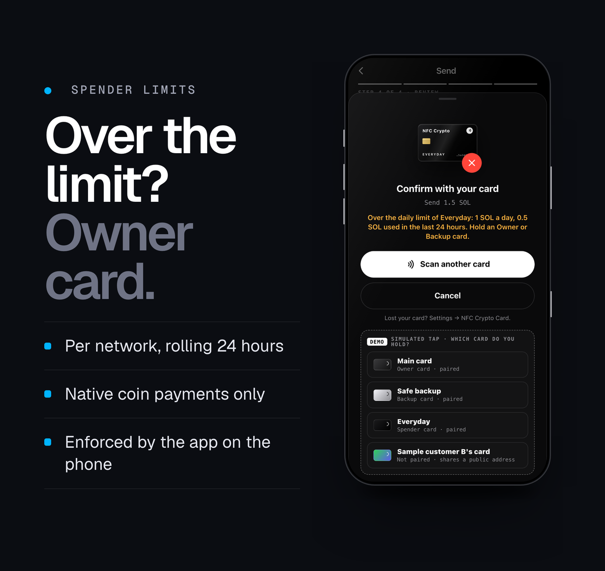
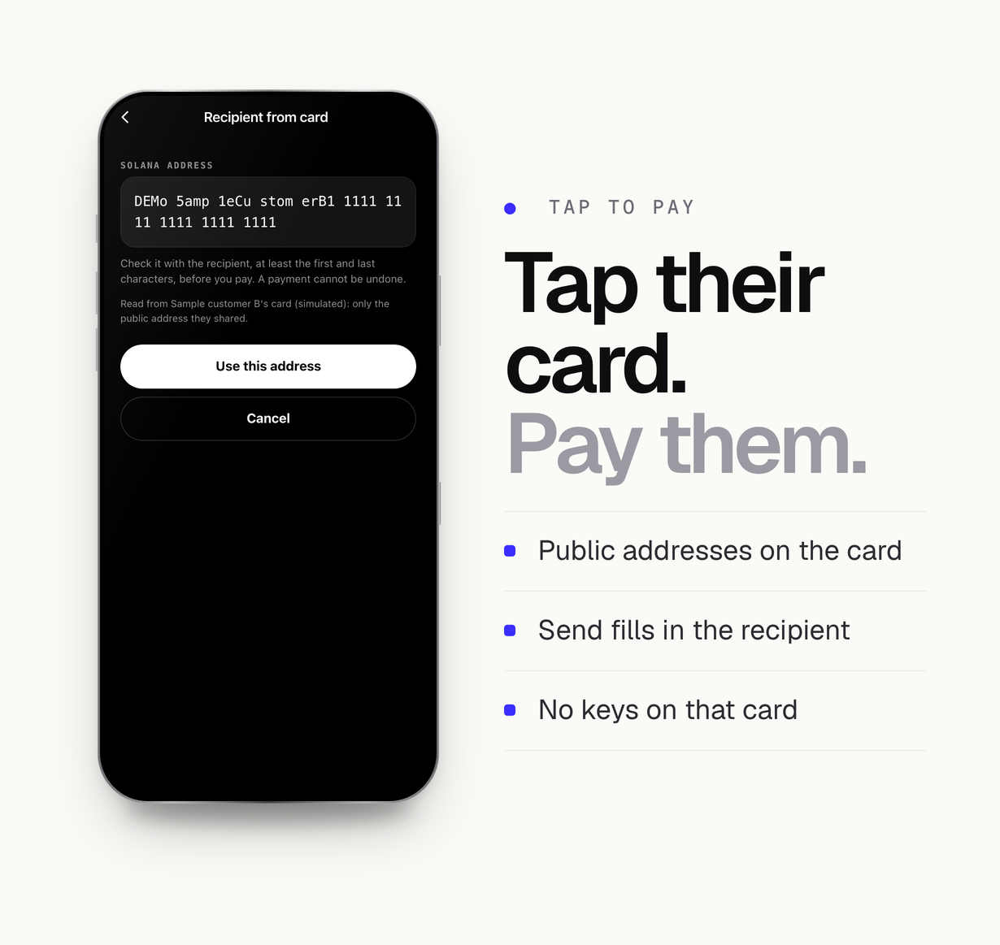
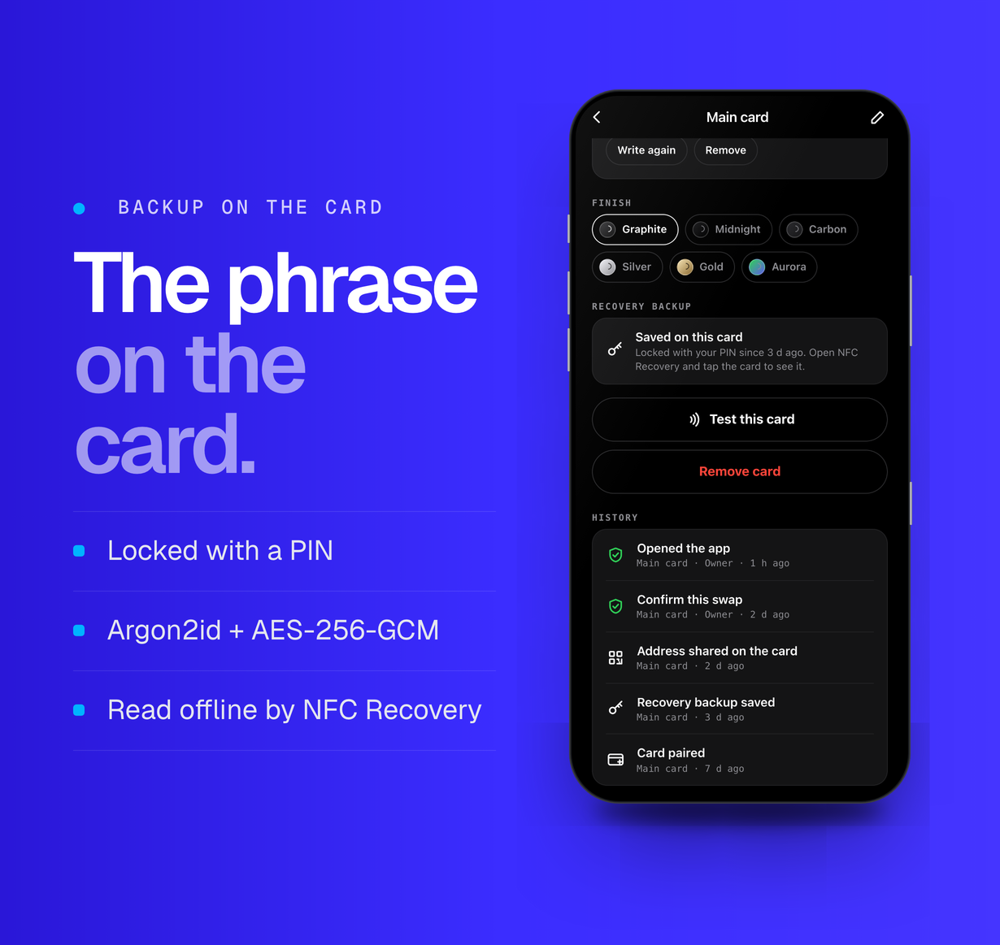
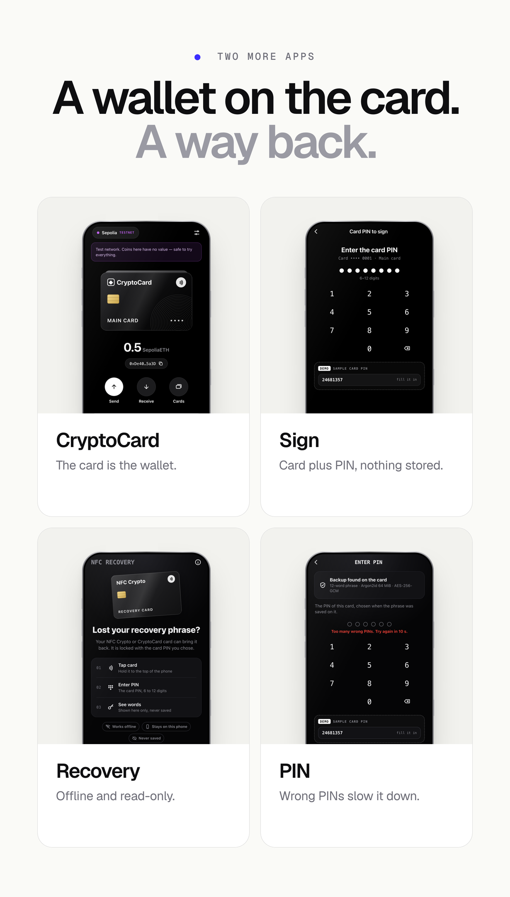
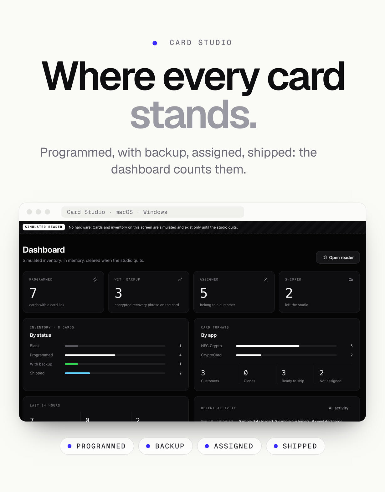

  

<h1 align="center">NFC Crypto Kit</h1>

  <b>Crypto wallet where an NFC card confirms every signature.</b>

NFC crypto wallet source code · card-confirmed signing · Flutter iOS & Android · hardware-style security

  <a href="https://nfccrypto-demo.mikodes.com/"><b>▶ Live demo</b></a> ·
  <a href="https://nfccrypto.mikodes.com/"><b>Website</b></a> ·
  <a href="https://store.mikodes.com/p/nfccrypto/"><b>Get the full source code</b></a>

  
  
  

  

> **This repository is a showcase.** It holds screenshots, documentation pointers and a real excerpt
> from the code. The full application is sold as source code at
> **[store.mikodes.com/p/nfccrypto](https://store.mikodes.com/p/nfccrypto/)**: one payment, instant ZIP download, free setup help.

---

## What it is

A wallet kit in which a physical NFC card must be tapped to approve each transaction, so a stolen unlocked phone cannot send funds. Includes a card studio for writing and cloning cards.

## Screens

 

 

 

## Features

- **NFC card confirms every signature**: A stolen unlocked phone cannot send without the physical card.
- **Card gate: require the card to open the app, for transactions, or both**: Card replaces Face ID where required.
- **PIN-encrypted seed backup on the card**: Recovery phrase survives a lost phone.
- **Card pairing, card list, card activity log**: Card tab is the home: cards, roles, today's spend, last approvals.
- **Native NFC bridges**: Tapping a card opens the app.
- **Multi-chain self-custody wallet: EVM**: One phrase, three chain families.
- **Send, receive, history, token detail, contacts, pending-tx re-check**: Everyday wallet functions.
- **Swap: Jupiter**: Swap inside the wallet, card-confirmed.
- **Solana staking**: Stake SOL from the wallet.
- **WalletConnect**: Connect to dApps.
- **Token approvals manager, security center, app lock**: Revoke risky allowances.
- **White-label in one file**: Rebrand all four apps for a client.

## How it works

A technical case study of the architecture, one end-to-end flow, the key engineering decisions and how you would build something like this: **[docs/HOW-IT-WORKS.md](docs/HOW-IT-WORKS.md)**.

## A look at the code

Real excerpts from the source, shown for illustration:

- **NFC spend policy** ([`snippets/nfc_spend_policy.dart`](snippets/nfc_spend_policy.dart)): Spender cards get a daily limit per network, counted over a rolling 24-hour window. A payment that would go over is refused until an Owner or Backup card is held.
- **Network time for the lost-card wait** ([`snippets/trusted_time.dart`](snippets/trusted_time.dart)): The 72-hour lost-card switch-off is measured with the median Date header of a few HTTPS hosts, not the phone clock. With no answer the wait does not finish.
- **Card guard inside every signer** ([`snippets/nfc_signing_guard.dart`](snippets/nfc_signing_guard.dart)): Every function that produces a signature calls the guard first, so a payment path that forgot the card prompt fails instead of signing silently.

## Requirements (full version)

- Flutter
- Dart SDK
- iOS
- Android
- Python
- Card Studio OS

Not included: Physical NFC cards; NFC reader hardware; Hosting and domain for the card link host and its app-link files; Apple Developer and Google Play developer accounts, app signing, store review; Third-party API keys/subscriptions.

## FAQ

**Is this the full source code?**  
No. This repository is a showcase with screenshots, a technical case study and real code excerpts. The complete NFC Crypto Kit source code is sold at [store.mikodes.com/p/nfccrypto](https://store.mikodes.com/p/nfccrypto/).

**What is NFC Crypto Kit built with?**  
Flutter, Python.

**Can I try it before buying?**  
Yes, open the [live demo](https://nfccrypto-demo.mikodes.com/).

**Do I get help with the installation?**  
Free setup help is included with the store purchase; questions go to [mikodes.com/support](https://mikodes.com/support).

## Get the full source code

  

One payment, full licence, instant ZIP download and free setup help.
Questions: [mikodes.com/support](https://mikodes.com/support).

---

  Made by <a href="https://mikodes.com"><b>MIKODES</b></a> · <a href="https://github.com/Mikodesteam">more projects</a>

