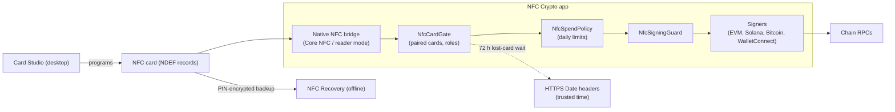

# How NFC Crypto works

A case study of a self-custody wallet where a physical NFC card confirms every signature, plus the small
kit of apps around it (a card-first wallet, an offline recovery reader and a desktop card studio).
It is written from the real code; short verbatim excerpts are in [`../snippets/`](../snippets/).

## The problem and who it is for

A phone unlock protects a wallet against strangers, but not against the moment the phone is already
unlocked, or someone knows the passcode. A hardware wallet fixes that and costs a separate device and a
different workflow. NFC Crypto sits in between: an ordinary NFC card is the physical second factor.
Hold it to the phone to open the app, to approve a payment, a swap or a dApp request, or to move a
recovery phrase back onto a phone. It is aimed at teams who want to offer a wallet with a physical
"tap to confirm" experience and sell or hand out cards, and at developers who want a working base for
that product.

## Architecture

The kit has four apps and one shared card format.

| App | Role |
| --- | --- |
| NFC Crypto (Flutter) | The main wallet: EVM networks, Solana and Bitcoin, swap, staking, WalletConnect, card gate, roles and limits. |
| CryptoCard Wallet (Flutter) | A card-first wallet: the keys live on the card, the phone is watch-only. |
| NFC Recovery (Flutter) | Offline reader for the PIN-encrypted backup on a card. |
| Card Studio (Python) | Desktop tool with an ACR122U reader: program, batch-program, clone, check and erase cards, with inventory and customer tracking. A simulated reader is included. |

There is no backend. The main wallet has no accounts, analytics, crash reporting or Firebase. The only
server the buyer hosts is a static host that serves the card links and the app-link files.

### What is on the card

A card carries a few NDEF records, each with its own job and its own version byte:

- **The card link:** one https universal link, `https://<host>/card/<id>`. iOS only opens an app from a
  background tag read when the first record is a universal link, so the card never carries a custom
  scheme. A second record on Android makes the tap open the wallet even when other apps claim the domain.
  The id is a random 128-bit identifier, not a secret.
- **The address record** (`mikodes.com:nfcaddr`): public receive addresses, so another phone can pay it
  with a tap. Never keys.
- **The backup record** (`mikodes.com:nfcseed`): the recovery phrase, encrypted with a PIN (details below).

Roles and limits are not stored on the card. They are kept on the phone next to the pairing, so the card
format stays shared and unchanged across all four apps.

## One flow end to end: a payment confirmed with the card

1. **The user starts a payment** in the send wizard, a swap, a WalletConnect request or a Solana action.
   The screen calls `confirmTransactionWithCard(reason: ...)`.
2. **The card is read.** The native bridge returns the card's NDEF records. The link record is parsed
   with a strict pattern: https only, the configured host, the `/card/` path and a 32-character hex id.
   A custom-scheme link is never accepted, because any web page or app can fire one.
3. **The card is matched to a pairing.** An unknown card gives "not paired". A card read that was cut
   short during a re-write is resolved against the id that was being written, so the owner's own card
   does not read as a stranger.
4. **The role decides.**
   - An **Owner** card approves anything and is the only one that pairs cards or changes roles and limits.
   - A **Backup** card approves any payment and the recovery phrase but cannot change the card setup.
   - A **Spender** card approves only plain native-coin payments, up to a daily limit per network.
     Anything else (a token transfer, a swap, a dApp call, an approval change) needs an Owner or Backup card.
5. **The spend limit is checked.** The sum of what this card approved on this network in the previous
   24 hours, plus the new amount, must stay within the limit (see
   [`nfc_spend_policy.dart`](../snippets/nfc_spend_policy.dart)). A limit of zero means "no limit set"
   and refuses the payment instead of allowing it.
6. **A short grant is opened.** A passed check opens a 90-second window in the `NfcSigningGuard` (see
   [`nfc_signing_guard.dart`](../snippets/nfc_signing_guard.dart)), long enough for an approval followed by a swap.
7. **The signer calls the guard anyway.** Every function that produces a signature calls
   `ensureAuthorized()` first. A payment path that forgot the prompt does not sign silently; it throws.
8. **The activity is logged** on the phone with the card name, role and purpose, and the signed
   transaction goes to the chain RPC.

## Key engineering decisions

### 1. The card is a physical second factor, not a cryptographic one

- **Chosen:** a card holds a random id and the app checks it against pairings. The code says openly that
  an NTAG215 card can be copied by whoever holds it. The requirement stops someone with the unlocked
  phone or the passcode but not the card.
- **Alternative:** a chip with signed one-time codes (NTAG424 DNA), which cannot be cloned.
- **Why:** NTAG215 and NTAG216 cards are cheap and widely available, and the honest threat model is
  documented in the code. A copy-proof card is named as the upgrade path rather than claimed.

### 2. A guard inside every signer, not only a prompt in the UI

- **Chosen:** the UI asks for the card, and every function that signs also checks a short-lived grant.
- **Alternative:** rely on the UI to always ask.
- **Why:** with dozens of screens that can start a signing, one forgotten path would be a silent bypass.
  Now a forgotten prompt becomes a visible error instead of a security hole.

### 3. Network time for the 72-hour "lost card" wait

- **Chosen:** a user who lost the card and does not have the recovery phrase can request that the card
  requirement turns off after 72 hours. The wait is measured in network time (the median of the `Date`
  headers of a few HTTPS hosts), and any scan of a paired card cancels it (see
  [`trusted_time.dart`](../snippets/trusted_time.dart)).
- **Alternative:** compare with the phone's clock.
- **Why:** anyone holding an unlocked phone can set the clock forward. With no network answer, the wait
  does not finish, which is the safe failure.

### 4. Limits enforced on the phone, counted from approval

- **Chosen:** daily limits are enforced by the app on that phone, over a rolling 24-hour window per card
  and network. The amount counts, not the fee, and a payment counts from the moment the card approves it
  even if it later fails.
- **Alternative:** an on-chain or server-side limit.
- **Why:** there is no backend and the kit stays serverless. The code states the limit is a rule of this
  app on this phone; the failure direction favours the owner.

### 5. A versioned, size-checked card format with a throttled PIN

- **Chosen:** each record has a version byte, strict length checks and a stored key-derivation cost so
  it can be raised later without breaking old cards. Readers reject the whole address record if one
  known key holds an invalid address.
- **Alternative:** a looser format that tolerates anything it can parse.
- **Why:** a card is data from the outside world. Treating it as untrusted input keeps a damaged or hostile
  card from steering the wallet.

## Security and safety measures that exist in the code

- **Recovery phrase on the card is encrypted with a PIN.** The payload is AES-256-GCM with a key derived
  by Argon2id (64 MiB memory, 4 passes for new backups), with the header bytes used as authenticated data.
  Only the entropy is stored, so a backup fits next to the link on an NTAG215. New backup PINs need at
  least eight characters and nothing trivial; older six-digit backups still open.
- **Lost-card recovery questions.** When a card is lost, the app asks for three random word positions of
  the recovery phrase. Wrong answers slow further attempts down, and the wait is persisted across restarts.
- **The card requirement can only be turned on after a scan,** so a user does not lock themselves out
  with a card they do not hold.
- **Spender restrictions.** A Spender cannot approve token transfers, swaps, dApp requests or approvals.
- **No custom-scheme card links,** because any app or page can fire them.
- **NFC Recovery** reads the backup offline, throttles PIN attempts, hides the words after 60 seconds,
  forbids copy, uses a secure-screen flag and refuses foreign card hosts.
- **Card Studio** handles PINs and phrases only as function arguments, never stores or logs them, and
  keeps decrypted entropy in a buffer that is zeroed after the operation. Clone re-encrypts to a new
  PIN and reads the card back byte for byte.
- **No backend, no analytics.** The wallet has no account system and no telemetry to leak.

## Testing approach

- Pure logic (spend policy, roles, link parsing, time parsing, address records) is separate from the
  platform code so it can be unit tested without a phone.
- A brand test fails when the white-label file and the native files (names, bundle id, card host) drift.
- Card Studio ships with a simulated reader that has virtual cards and a separate in-memory inventory.

## How you would build something like this

1. **Decide the threat model before the format.** Write down what the card protects against and what it
   does not. This kit chose "stolen unlocked phone", not "cloned card".
2. **Design the card format as a tiny protocol.** Records, version bytes, fixed sizes, and a reader that
   rejects anything it does not understand fully.
3. **Build the native bridges first** (Core NFC on iOS, reader mode on Android) with one small channel
   interface, so the Dart side is testable with a fake.
4. **Add the guard at the signer level,** then add the UI prompts. Do it in this order so you cannot ship a
   path that skips the guard.
5. **Add roles and limits as policy objects with no I/O,** with the clock injected. They are the part
   most worth testing.
6. **Handle the lost-card case deliberately:** a recovery path, a delayed disable and a trusted clock.
7. **Add the tooling around the card** (programming, cloning, inventory) as a separate app, so the
   wallet does not carry operator tooling.
8. **Make rebranding one file,** with a test that checks the native files agree with it.

## Deployment and customization

- **White label in one file:** name, colours, card host, networks, RPC endpoints, routers and swap fee.
  Native files (Info.plist, entitlements, Android manifest) must agree with it, and a test checks that.
- **Card host:** you host the app-link files (apple-app-site-association and assetlinks.json) on the
  domain used for the card links.
- **Hardware:** NTAG215 or NTAG216 cards and, for Card Studio, an ACS ACR122U reader are not included.
- **Accounts and keys:** Apple and Google developer accounts and any third-party API keys you enable
  (WalletConnect project, swap aggregators, block explorers) are yours.
- **Custody:** the kit takes custody of nothing. Keys stay on the user's phone or card.

Full source code, docs and setup help: https://store.mikodes.com/p/nfccrypto/
